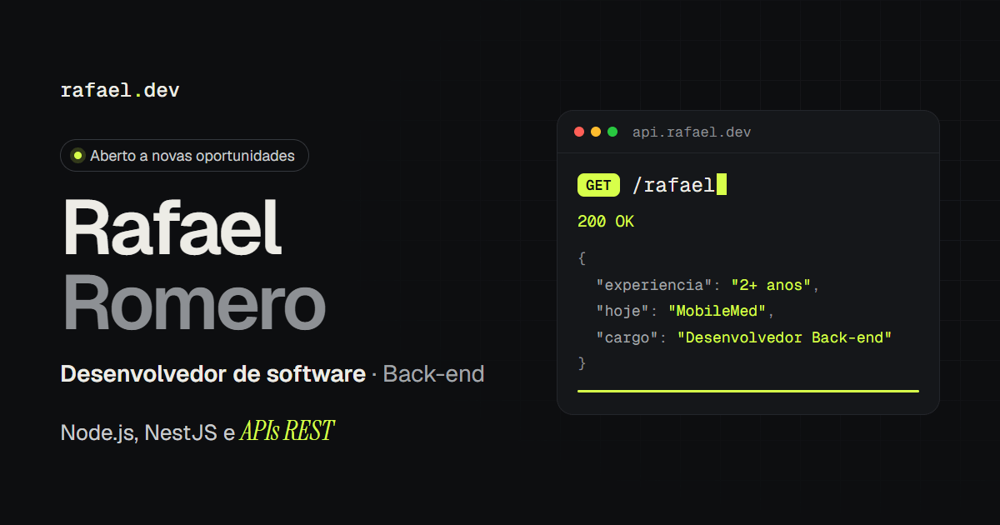

# rafael.dev

Portfólio pessoal de Rafael Romero, desenvolvedor de software com foco em back-end (Node.js, NestJS e APIs REST).

**Site:** [rafael-romero.vercel.app](https://rafael-romero.vercel.app)



## Destaques

- **Painel `api.rafael.dev`:** enquanto a página rola, cada seção "responde" como um endpoint. O painel digita a rota (`GET /experiencia/mobilemed`, `GET /stack`, `POST /contato`…), mostra o status e avança uma barra de progresso. Na linha do tempo, o item ativo acende.
- **Duas colunas:** o perfil fica fixo à esquerda e o conteúdo rola à direita. A coluna fixa se ajusta à altura da tela sem barra de rolagem.
- **Celular:** abaixo de 960px vira uma coluna só, e o painel vira uma faixa presa logo abaixo do menu.
- **Acessibilidade:** respeita `prefers-reduced-motion` (sem digitação nem animações), tem foco visível no teclado e marca os elementos decorativos com `aria-hidden`.
- **Sem framework de UI:** HTML gerado pelo Astro, CSS puro com estilos escopados por componente e um único script em TypeScript.

## Stack

- [Astro](https://astro.build) com TypeScript
- CSS puro, com cores, fontes e medidas em variáveis (`src/styles/global.css`)
- Fontes via [Fontsource](https://fontsource.org): Geist, Geist Mono e Instrument Serif
- `astro:assets` para otimizar os logos (WebP em 1x e 2x)

## Estrutura

```text
public/              arquivos servidos como estão (currículo, favicon, imagem de prévia)
src/
├── assets/logos/    logos das empresas, otimizados no build
├── components/      Header, Sidebar, FaixaApi, Experiencia, Stack, Formacao, Contato, Rodape
├── data/            conteúdo do site (perfil, experiências, stack, formação)
├── layouts/         HTML base, metadados e Open Graph
├── pages/           index.astro, que monta a página
├── styles/          variáveis e reset globais
└── utils/           formatação de datas
```

## Rodando localmente

É preciso ter o Node.js 22.22 ou mais recente.

```sh
npm install
npm run dev       # http://localhost:4321
npm run build     # gera o site estático em dist/
npm run preview   # serve o build para conferir antes de publicar
```

## Editando o conteúdo

Todos os textos vêm de `src/data/`. Para incluir uma experiência, basta adicionar um item em `experiencia.ts`. Se ele não tiver `logo`, o site mostra a inicial da empresa.

O painel da API lê atributos HTML, então qualquer elemento da página pode virar um passo, na ordem em que aparece:

| Atributo        | Exemplo                | Obrigatório               |
| :-------------- | :--------------------- | :------------------------ |
| `data-endpoint` | `"GET /stack"`         | sim                       |
| `data-status`   | `"201 Created"`        | não (padrão: `"200 OK"`)  |
| `data-detalhe`  | `"21 tecnologias"`     | não                       |

Para que links compartilhados mostrem a imagem de prévia, defina o domínio em `astro.config.mjs` (`site: 'https://...'`). As redes sociais exigem o endereço completo da imagem.

## Uso

O código pode servir de referência. Os textos e o currículo são pessoais, e os logos pertencem às respectivas empresas.
